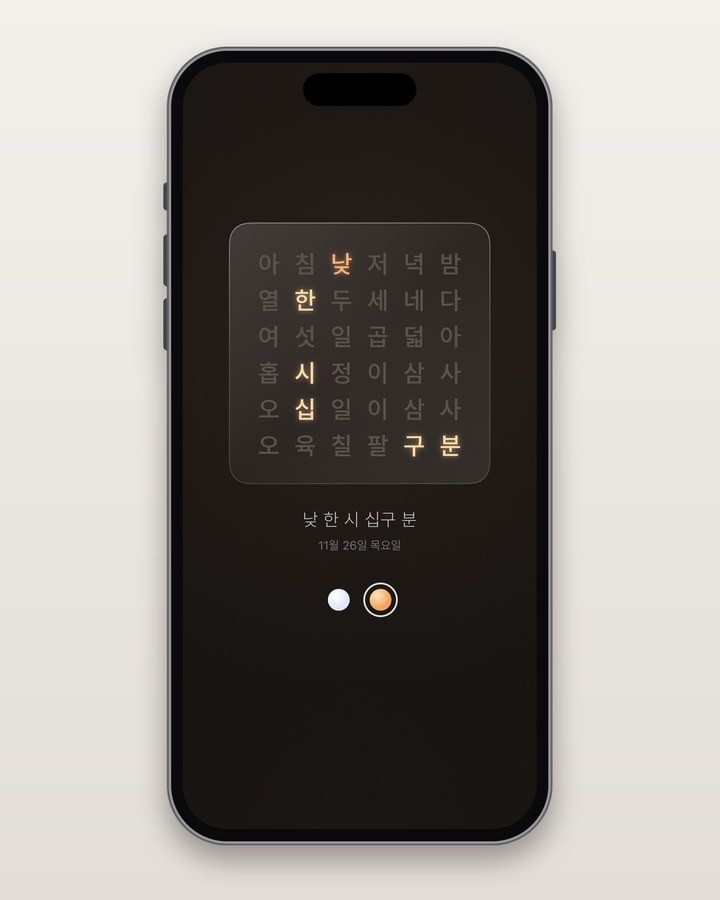
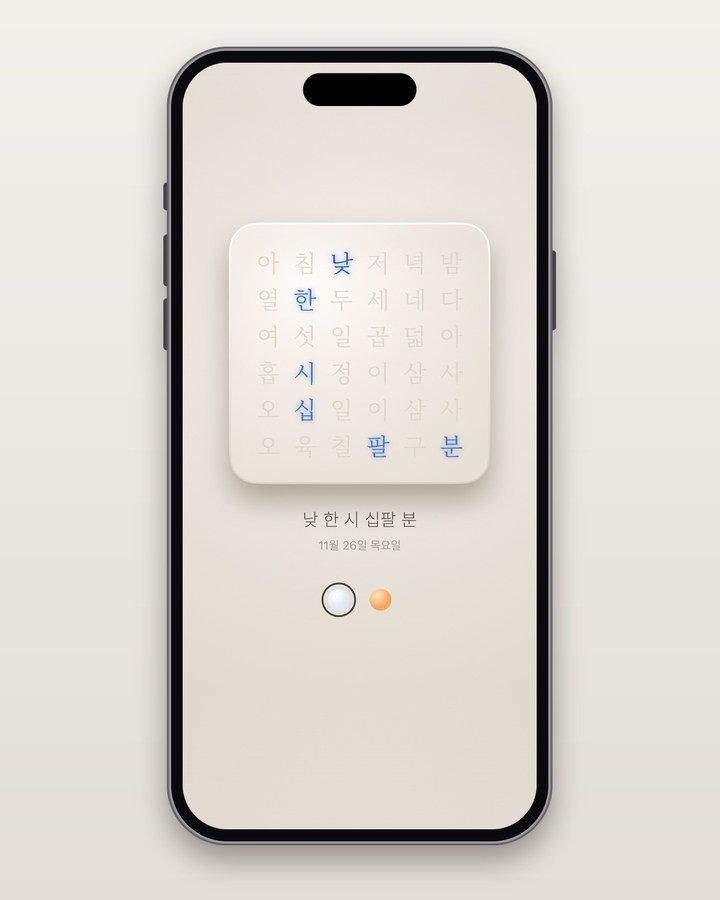
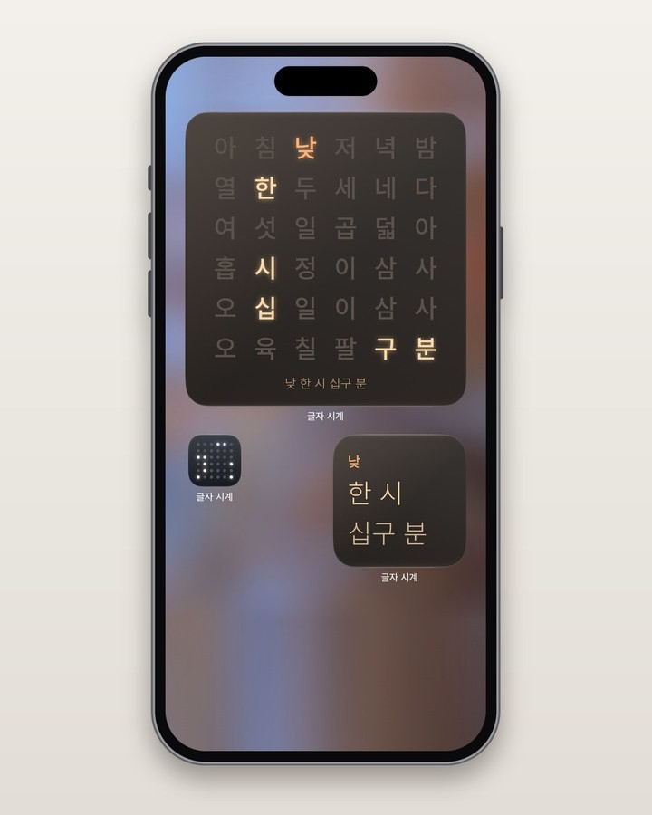
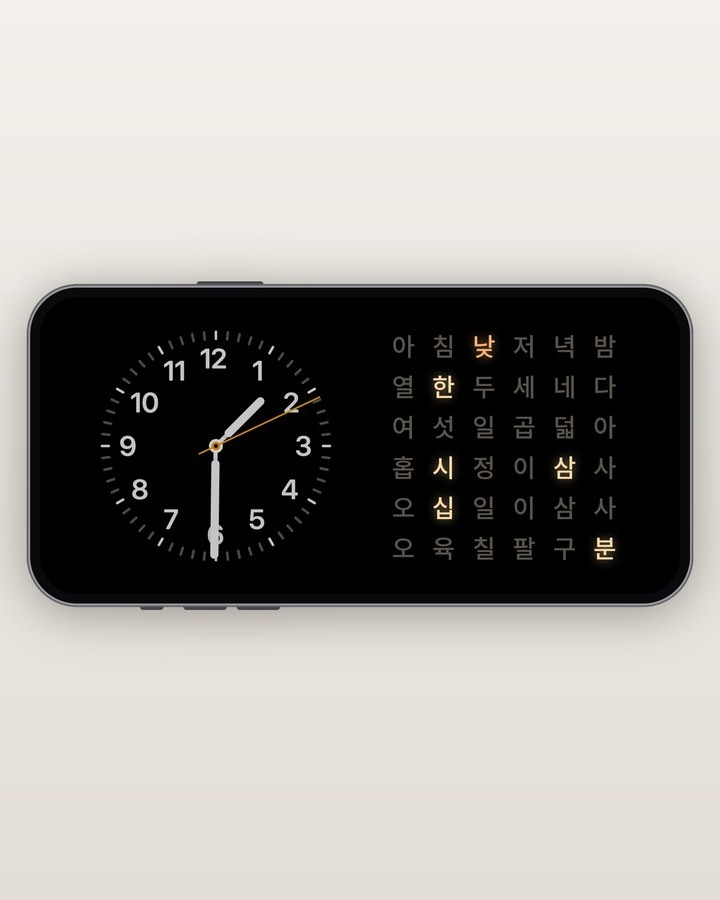

# 한글 글자 시계 (Hangul Word Clock)

6×6 한글 글자판에서 지금 시각의 글자에만 불이 켜지는 아이폰 시계입니다. 앱, 홈 화면 위젯, 잠금화면 위젯, StandBy(충전 중 탁상시계)에서 씁니다.

<p>
  
  
  
  
</p>

## 글자판

```
아 침 낮 저 녁 밤
열 한 두 세 네 다
여 섯 일 곱 덟 아
홉 시 정 이 삼 사
오 십 일 이 삼 사
오 육 칠 팔 구 분
```

예: 오후 1시 29분이면 `낮`, `한`, `시`, `이`, `십`, `구`, `분` 에 불이 켜집니다. 낮 12시 정각에는 `정오` 만 켜집니다.

## 할 수 있는 것

- 1분마다 글자가 바뀝니다. 때는 아침 · 낮 · 저녁 · 밤으로 나눕니다.
- 재질 3가지: 서리 유리, 백자, 직물. 앱 화면을 옆으로 밀어 바꿉니다.
- 빛 색 2가지: 주광색(차가운 흰빛), 전구색(호박빛). 고른 색은 홈 화면 위젯에도 쓰입니다.
- 홈 화면 위젯: 글자 판(작게 · 크게), 글자 문장.
- 잠금화면 위젯: 날짜 옆 한 줄, 직사각형, 동그라미.
- StandBy: 충전하면서 가로로 눕혀 두면 탁상시계가 됩니다.

## 설치

App Store 에는 없습니다. 맥에서 Xcode 로 빌드해 내 아이폰에 설치합니다. 무료 Apple ID 로 됩니다.

순서는 [ios/README.md](ios/README.md) 에 있습니다. 필요한 것은 맥, Xcode, iOS 17 이상 아이폰, USB 케이블입니다.

경고: 무료 Apple ID 로 설치한 앱은 7일이 지나면 열리지 않습니다. 7일마다 다시 설치합니다.

## 개인정보

- 앱은 인터넷에 접속하지 않습니다.
- 앱이 저장하는 것은 고른 빛 색과 재질 두 값뿐입니다. 이 값은 아이폰 안(앱과 위젯이 함께 쓰는 설정)에만 있습니다.
- 위치 · 사진 · 연락처 같은 권한을 요청하지 않습니다.

## 폴더

| 폴더 | 내용 |
|---|---|
| `ios/` | 아이폰 앱(`App`), 위젯(`Widgets`), 공용 Swift 패키지(`HangulClockKit`) |
| `preview/` | 규칙의 정본(`clock-core.js`)과 브라우저 미리보기(`index.html`) |
| `tools/` | 규칙 표 만들기(`gen_tables.js`), 빌드 · 시험(`ios.sh`), 앱 아이콘 · 글꼴 만들기 |

## 주석에 보이는 번호

- 코드 주석의 "스펙 I3", "D4", "기록장" 같은 말은 공개하지 않은 설계 문서의 결정 번호입니다. 그 문서가 없어도 빌드와 시험에는 지장이 없습니다.
- 주석에 나오는 `firmware/` 와 Chain Captain 은 같은 규칙으로 만들고 있는 M5Stack 작은 화면(240×240) 기기 판입니다. 이 저장소에는 들어 있지 않습니다.

## 만든 과정

Threads 에서 본 나무 액자 한글 글자 시계 사진을 보고 시작했습니다. 코딩은 Claude Code 가 했고, Codex 와 Gemini 가 디자인과 코드를 검토했습니다.

## 라이선스

- 코드: MIT. [LICENSE](LICENSE) 를 봅니다.
- 글꼴: SIL Open Font License 1.1. Noto Sans KR, Noto Serif KR, IBM Plex Sans KR 에서 판 글자 30자만 남기고 이름을 바꿨습니다(HCSans, HCSerif, HCGrotesk). 라이선스 전문은 `ios/HangulClockKit/Sources/HangulClockUI/Fonts/licenses/` 에 있습니다.

---

## English

A Korean word clock for iPhone. A 6×6 grid of Hangul characters lights up only the words that spell the current time, updated every minute. It runs as an app, home screen widgets, lock screen widgets, and in StandBy.

- Three materials (frosted glass, porcelain, fabric) and two light colors (daylight, warm bulb).
- Not on the App Store. Build it with Xcode on a Mac and install it on your own iPhone (iOS 17 or later). A free Apple ID works, but the app must be reinstalled every 7 days. See [ios/README.md](ios/README.md) (Korean).
- The app makes no network connections and asks for no permissions.
- Code: MIT. Fonts: SIL OFL 1.1 (subsets of Noto Sans KR, Noto Serif KR and IBM Plex Sans KR, renamed).
